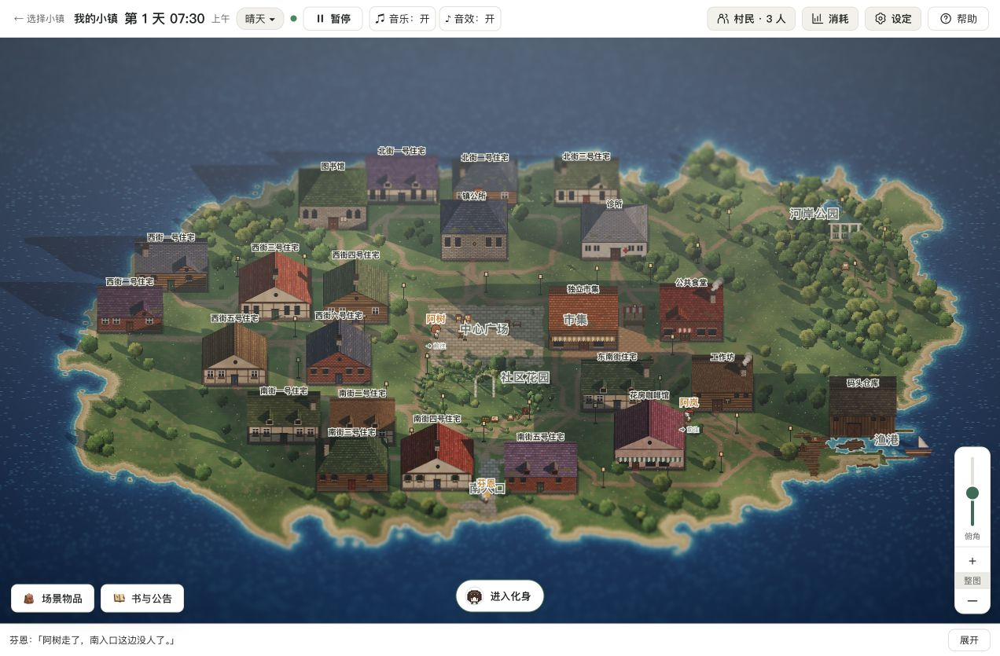
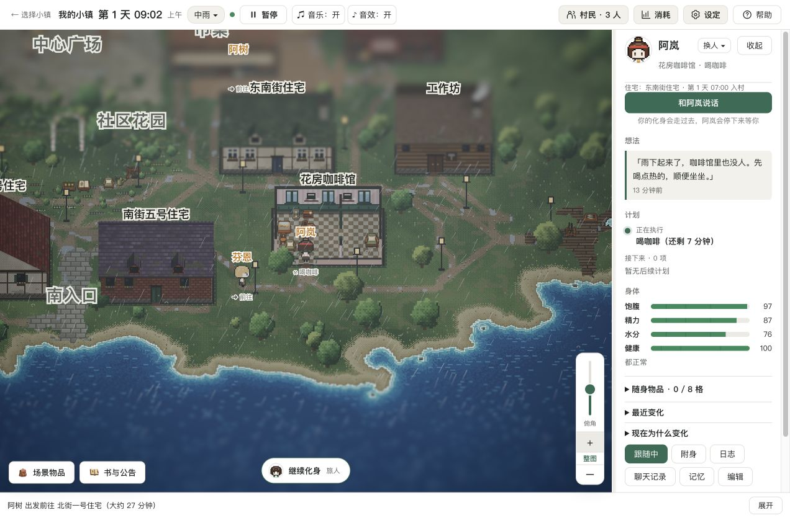
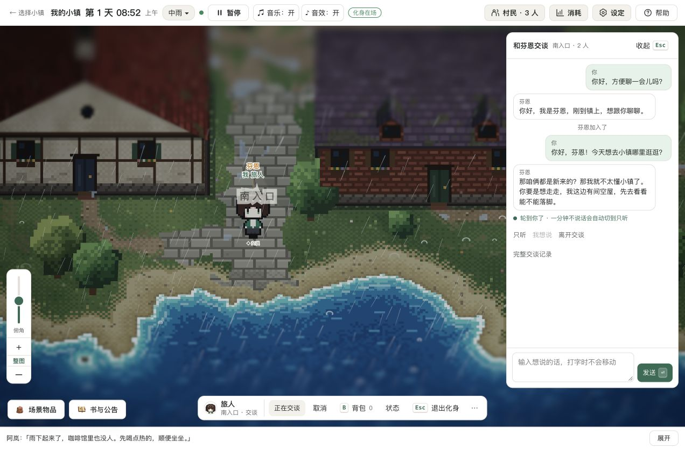

# AI 小镇

一个由 AI 居民自己过日子的小镇。你可以在旁边观察，也可以用自己的化身走进去，和他们说话。

居民会安排日常、使用物品、结识邻居，并记住亲身经历。模型负责提出想法和行动，世界内核负责检查和执行；发生了什么，以世界里的实际结果为准。



> **这个仓库继续开发了。** 当前 `main` 已换成 Rust 世界内核与 HD-2D 客户端，后续开发统一在这里进行。原 Godot 版保留在 Git 历史中，见[旧版最后快照](https://github.com/mewamew/my_ai_town/tree/e8a1ee3cdb29c8b3650f7801a801db2ef30e4828)。
>
> **Windows 尚未实机测试。** Windows 应用壳和交叉编译脚本已经加入，但启动、WebView2、内置模型、存档及中文路径仍需实机验证。
>
> 新版目前提供源码和打包脚本。仓库既有的 Godot 版 Release 不对应本文截图和运行方式，请勿混用。

## 这次更新了什么

- **HD-2D 小镇。** 像素风角色、立体场景、昼夜和天气变化；可以拖动、缩放地图，也可以跟随某位居民。
- **看得见的居民生活。** 查看正在做的事、想法、计划、身体状态、日记、聊天和记忆；居民的行动会受到环境、需求与经历影响。
- **走进小镇。** 创建自己的化身，与居民交谈、使用物品、写书或贴公告，也可以接管一名居民。
- **自己的居民和小镇。** 从村民库邀请居民，修改人设和外观；可以创建新小镇、编辑地图，也可以接入在线模型生成小镇描述和人设。
- **本地小模型。** 提供专门用于村民日常决策的内置模型接入，不必为村民行动配置 API 密钥；也可给居民选择在线模型。
- **新的底层实现。** Rust 负责世界、Agent、协议与存档；浏览器客户端使用 TypeScript、Three.js。Android、macOS、Windows 的应用壳共用这套前端。





以上为 2026-10-19 在 macOS 的 Chrome 中运行新版源码时截取的画面，使用独立演示存档和本地模型。每次运行的行动与对话会不同。

## 怎么开始

第一次进入小镇，向导会带你选模型、邀请居民、填写世界观，然后开始运行。可以先用自带的小镇和默认居民。

- **观察：** 左键拖动平移、滚轮缩放；按住右键左右拖动环绕小镇，上下拖动调整俯角。点击「街景」或「俯视」恢复预设方向。点居民查看详情，空格暂停或继续。
- **化身：** 点「进入化身」；点地图走过去，也可用 WASD 移动，E 互动，B 打开背包。
- **设置：** 在「设定」里调整模型和居民；顶栏可查看模型消耗、切换天气。
- **保存：** 返回「选择小镇」时保存并关闭当前小镇。个人地图、居民、记忆和日志保存在本机用户目录，不会写回仓库。

### 从源码启动

Windows 可运行 `node scripts/windows/build-local-launcher.mjs`，在根目录生成 `AI小镇启动.exe`。双击会启动本地 Ollama 和小镇服务，再打开浏览器。沿用 `.local/run-data` 中的存档；打开的是选镇页，进入小镇后再手动开始运行。重复双击会复用服务。启动器需要保留在项目根目录，依赖本机已安装的 Node.js、已编译的 Rust 内核和现有模型，不是可单独拷走的安装包；生成的 EXE 不随源码入库。配置方法见[Windows 本地启动器](docs/README.md#windows-本地启动器)。

先安装 Node.js（见 `.nvmrc`，最低 22.18）、Corepack 和 Rust 工具链 1.88.0。在 macOS 上按以下步骤运行：

```sh
git clone https://github.com/mewamew/my_ai_town.git
cd my_ai_town
corepack pnpm install --frozen-lockfile
cargo +1.88.0 build --locked -p host --bins
corepack pnpm build
corepack pnpm preview
```

打开 `http://127.0.0.1:5174`。

源码仓库不包含内置模型的推理程序和权重。要在 Apple 芯片的 Mac 上使用本地模型，先准备 CMake 和 Xcode 命令行工具，再运行：

```sh
node scripts/builtin-model/build.mjs
```

这会下载固定版本的 llama.cpp 并编译推理程序。重启管理服务后，到「设定 → 内置模型」下载模型文件（约 529 MB）；下载完成后，村民决策可在本地运行。仅运行上面的前端与 Rust 构建，不会自动编译推理程序。

也可以在游戏里配置自己的在线模型地址和 API 密钥。在线调用的费用由服务商收取；居民越多、运行越久，请求通常越多。请先从少量居民开始。

开发模式、平台打包和检查命令见[开发入口](docs/README.md)。

## 平台状态

| 平台 | 当前情况 |
| --- | --- |
| macOS / 浏览器 | 本次已在 Apple 芯片的 Mac 上完成源码编译、Chrome 启动和核心流程检查。 |
| macOS 应用 | 提供 Swift 应用壳与 DMG 打包脚本，目标为 macOS 13+、Apple 芯片；本次源码发布不附带新签名或公证的 DMG。 |
| Android | 提供应用壳与 APK 打包脚本，目标为 Android 8.0+、arm64；内置模型还要求 CPU 支持 armv8.2-a、dotprod、fp16。本次未重新做手机实机验收。 |
| **Windows** | **尚未实机测试。** 目标为 Windows 10/11 x64、WebView2；内置模型要求 AVX2 等指令集。Mac 上交叉编译成功也不能代替 Windows 实机验证；当前应按实验性支持看待。 |
| Linux / 其他设备 | 未在本次发布中验证；不要将核心 CI 通过理解为所有平台都能正常运行。 |

## 数据、模型和旧版

- macOS 数据目录：`~/Library/Application Support/MyAiTown`；Windows 目标目录：`%LOCALAPPDATA%\MyAiTown`。可通过 `AI_TOWN_HOME` 指向独立数据目录，适合测试和备份。
- 新版不会自动读取、转换或删除旧 Godot 存档。升级前保留旧版目录和存档，需要旧版时从历史快照使用。
- 村民行动来自模型。模型不可用时会暂停相关决策；本地模型的能力和速度受设备限制，不保证每次都能做出合理决定。
- 内置模型用于村民生活；一句话建镇和写人设仍需要在线模型。首次下载模型与检查更新需要联网。
- API 密钥保存在本机。使用在线模型时，相应请求中的人设、对话、记忆和世界上下文会发送给你配置的服务商；不要在公开 Issue 中粘贴密钥或未经检查的存档、日志。

## 授权与参与

项目原创代码与文档采用 **[PolyForm Noncommercial 1.0.0](LICENSE)**，即源码公开、仅限许可条款定义的非商业用途。允许相应的学习、修改和分享；商业使用需要另行取得授权。许可还明确允许其中列举的教育、公益、公共研究、政府等机构使用，具体以英文全文为准。

第三方依赖、Kenney 音效、llama.cpp 和下载的模型沿用各自许可，其既有权利不受项目非商业限制。音乐、美术与图标已由维护者确认自有或已获授权，可随项目分发；具体范围见 [NOTICE](NOTICE) 和[素材说明](licenses/ASSETS.txt)。

欢迎在 [Issues](https://github.com/mewamew/my_ai_town/issues) 反馈。请附上系统、启动方式、复现步骤和脱敏后的报错；Windows 反馈请注明系统版本与 WebView2 情况。提交改动前请阅读 [AGENTS.md](AGENTS.md) 并运行[检查命令](docs/README.md#检查)。当前 `crates/` 的核心改动由维护者处理，其余改动可通过 PR 提交。

交流群：QQ群 130703560。
